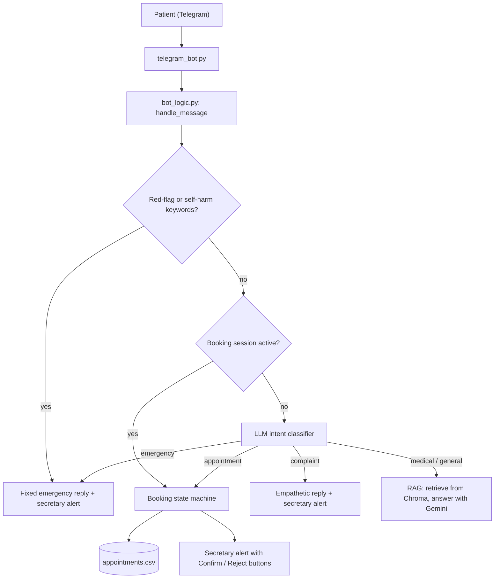

# Clinic AI Assistant

A Persian-language Telegram assistant for a pain-management clinic. It answers questions about the clinic using Retrieval-Augmented Generation (RAG), escalates risky messages to a human, and collects appointment requests that the clinic secretary confirms or rejects directly from Telegram.

> **Status:** working proof of concept. All clinic details in this repository are placeholders ("Dr. X"). This is **not** a medical device: it does not diagnose, and it does not recommend medication.

## Features

- **Persian Q&A over a clinic knowledge base**: opening hours, services, required documents, FAQs. Answers are grounded in retrieved text (Gemini embeddings + Chroma); if the answer is not in the knowledge base, the bot says so and refers the patient to the secretary instead of guessing.
- **Safety-first routing**: a deterministic red-flag keyword layer runs *before* any LLM call. Emergency symptoms and self-harm messages get a fixed, reviewed reply and an immediate alert to the secretary.
- **Intent classification**: an LLM classifies the remaining messages as `emergency`, `appointment`, `complaint`, `medical`, or `general`.
- **Guided appointment requests**: a step-by-step booking flow (name, phone, preferred time, reason, confirmation) with phone-number validation. It is a plain state machine, not an LLM, so it behaves predictably.
- **Human in the loop**: the secretary receives alerts in Telegram with inline *Confirm / Reject* buttons, and the patient is notified of the decision. The bot never promises a booking on its own.
- **Guardrails**: the prompt forbids diagnoses, drugs, and doses, and invites the patient to an in-person visit instead.

## How a message is handled



## Tech stack

- Python (developed on 3.13)
- LangChain, Google Gemini (generation: `gemini-3.5-flash-lite`, embeddings: `gemini-embedding-001`)
- Chroma (local vector store)
- python-telegram-bot
- arabic-reshaper + python-bidi (only for readable Persian output in the terminal)

## Project structure

```
.
├── rag_core.py                # knowledge base ingestion, retriever, RAG answer
├── bot_logic.py               # red-flag layer, intent routing, booking flow
├── telegram_bot.py            # Telegram handlers, secretary alerts and buttons
├── clinic_info.example.txt    # sample knowledge base (copy to clinic_info.txt)
├── .env.example               # required environment variables
├── requirements.txt
└── README.md
```

## Setup

```bash
git clone https://github.com/arsalwnn/clinic-ai-assistant.git
cd clinic-ai-assistant

python -m venv venv
# Windows: .\venv\Scripts\Activate.ps1      Linux/macOS: source venv/bin/activate
pip install -r requirements.txt
```

1. Copy `.env.example` to `.env` and fill in the values below.
2. Copy `clinic_info.example.txt` to `clinic_info.txt` and edit it with the clinic's real information.
3. Optional: test retrieval in the terminal with `python rag_core.py`.
4. Run the bot:

```bash
python telegram_bot.py
```

### Environment variables

| Variable | Description |
|---|---|
| `GOOGLE_API_KEY` | Gemini API key from Google AI Studio |
| `TELEGRAM_BOT_TOKEN` | Bot token from @BotFather |
| `SECRETARY_CHAT_ID` | Telegram chat id that receives alerts and approves appointments (send `/myid` to the bot to find yours) |

If the Google API or Telegram is not reachable from your network, set `HTTP_PROXY` and `HTTPS_PROXY` in your shell before running.

When you change `clinic_info.txt` or the embedding model, delete the `chroma_db/` folder so the index is rebuilt.

## Design decisions

- **Safety rules are deterministic and run first.** Whether a message is an emergency should not depend on a model's judgment alone. The keyword list errs on the side of over-alerting.
- **Booking is a state machine.** It collects personal data and must be reliable and validated, so no LLM is involved.
- **Appointment requests, not bookings.** The secretary has the final say, which avoids double-booking and keeps a human accountable.
- **Knowledge base is plain text.** Adapting the assistant to another clinic means editing one file.
- **The vector index is persisted**, so documents are embedded once instead of on every start.

## Limitations and roadmap

- The red-flag keyword list is a starting point and **must be reviewed by a physician** before any real use.
- Appointments are stored in a local CSV; Google Sheets / Calendar integration is planned.
- Conversation state is kept in memory and is lost on restart.
- There is no evaluation set yet. Planned: retrieval and answer-quality tests, and recall tests for the red-flag layer.
- No consent flow or data-retention policy yet. The CSV contains patient names and phone numbers in plain text, which must be addressed before real use.
- Only Telegram is implemented; a WhatsApp channel is planned.

## Disclaimer

This project is a technical demo. It is not a medical device and must not be used for diagnosis or treatment decisions. In an emergency, contact local emergency services (115 in Iran).

## Author

AmirArsalan Rezaianzadeh · [GitHub](https://github.com/arsalwnn) · [LinkedIn](https://www.linkedin.com/in/amirarsalan-rezaian-zadeh-a8ab10426)
